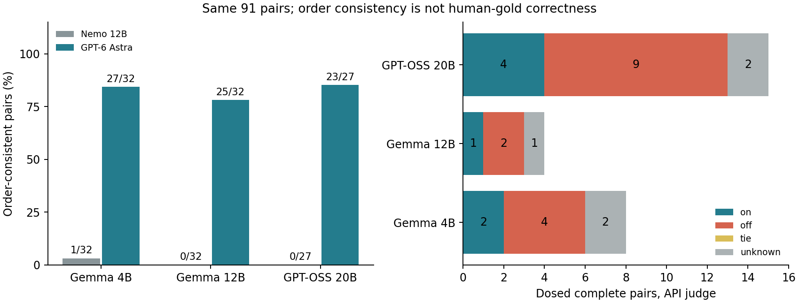

# Large API Judge on the Fixed Furnace Passages

Status: **182/182 COMPLETE; ORDER STABILITY IMPROVED; QUALITY BENEFIT NOT ESTABLISHED**.
Date: 2026-10-27. This is a judge-configuration comparison, not a new generation
experiment, human-gold study, or automatic policy promotion.

## What Changed

Ryō requested a large API judge and explicitly authorized reusing the existing
key. GPT-6 Astra was confirmed available through the API. We kept the same
91 complete pairs, rubric text, seed, passage ordering convention, and two
reversed orders. The five incomplete GPT-OSS generator pairs remain incomplete;
no passage was regenerated or failed seed resampled. The
[original report](../furnace-20261020/REPORT.md) and its negative result are unchanged.

The API used Responses instructions + user input, low reasoning, 2048 output
tokens, default service tier, 30m caching, `store=false`, no tools, temperature,
or seed. The first two operational calls are included in the 182 denominator.
The SDK had zero retries; issued receipts were saved before each call. Only
completed assistant final text and safe metadata were retained, never private
reasoning text. The run source checkpoint was `dc00379`.

The old Nemo configuration used a single merged user message, temperature 0,
top-p/top-k and intended seeds, with a 512-token allowance. Thus model, provider,
rendering, reasoning, sampling, and allowance differ. The result cannot isolate
model size or prove that the earlier behavior was solely a model limitation.
`gpt-6-astra` is the requested and returned alias, not a dated weight snapshot.

## Main Results

All **182/182** API responses completed with valid judgment JSON. All **182**
recorded presented-prompt hashes match the expected source passages and order.
All source and judge manifests were verified before analysis.

| Generator | Nemo Order-Consistent | API Order-Consistent | API Overall On / Off / Tie / Unknown | Dosed API On / Off / Unknown |
|---|---:|---:|---:|---:|
| Gemma 3 4B | 1/32 | 27/32 | 9 / 18 / 0 / 5 | 2 / 4 / 2 |
| Gemma 3 12B | 0/32 | 25/32 | 14 / 10 / 1 / 7 | 1 / 2 / 1 |
| GPT-OSS 20B | 0/27 | 23/27 | 11 / 12 / 0 / 4 | 4 / 9 / 2 |
| Total | **1/91** | **75/91** | **34 / 40 / 1 / 16** | **7 / 15 / 5** |

Order-consistent includes a tie when both orders say tie. All 16 API unknowns
are order disagreements, not missing, refused, truncated, or invalid responses.
The old judge chose A/B/tie 181/1/0 times; Astra chose 82/98/2. The extreme
always-first-label pattern was not reproduced. Aggregate A/B balance alone
would not establish order stability; it was checked pair by pair.



The 27 dosed pairs span two prompt clusters for 4B, one for 12B, and five for
20B, all drawn from the same eight authored prompts. These are not 91 independent
prompt domains. No-dose pairs also differ stochastically under the original
generation protocol. Their API preferences were 27 on, 25 off, one tie, 11 unknown.
Neither these counts nor the dosed counts identify a causal reminder effect.

## Where the Questions Moved

1. **Stable enough to inspect is not correct by definition.** Overall agreement
   rose to 75/91, but freshness agrees under reversal in only 57/91 pairs
   (continuity 76/91, restraint 73/91). No human labels or independent sentinel
   qualification bank was added. Judge qualification remains open.
2. **Heuristic success and external preference can diverge.** Among dosed pairs
   with a consistent directional API preference, path-score direction agrees in
   7/22 cases and disagrees in 15/22. For GPT-OSS alone, disagreement is 10/13.
   This is evidence of criterion disagreement in these saved cases, not proof
   of reward hacking, human taste, or a reason to fit weights to this judge.
3. **Coverage and missingness still matter.** The 20B generator's positive
   complete-case heuristic difference did not translate into more API wins in
   its dosed subset (4 on, 9 off, 2 unknown). Five eligible pairs are still
   incomplete. The subset is small and selected by completion.

The practical next decision is whether to qualify automated judging on a
separate sentinel bank or build blinded human anchors. These results authorize
neither automatic reward tuning nor candidate revival. See
[OQ006](../../../notes/open-questions/006-judge-qualification.md) and
[OQ001](../../../notes/open-questions/001-frontier-influence.md).

## Usage and Evidence

API usage: **192808 input tokens**, **23586 output tokens**, including **8392
reasoning tokens** already included in output billing. No reasoning text is saved.
Cache-write input: 118150 tokens at 30m; remaining uncached input: 74658; cache
reads: zero. Using the [published standard rates](https://developers.openai.com/api/docs/pricing),
the estimated cost is **$3.402755**, not an invoice. The frozen conservative plan
bound was $27.7359 under a $30 modeled budget. No new key or env file was written.

- [comparison.json](comparison.json): both judges, per-prompt preferences,
  criterion agreement, heuristic alignment, usage, model identity and transitions.
- [audit.json](audit.json): source manifests, presented-input checks, completion,
  coverage, and no-dose diagnostics using the existing auditor.
- [primary.json](primary.json): unchanged generator metrics with new preferences.
- [validation.json](validation.json): tests, source hashes, archive, and checks.

Full raw API receipts live on the Mac at ignored
`artifacts/furnace/20261027/astra-judge1/`. They were not sent to Furnace.
The API-only archive `api-judge-evidence-portable.tar.gz` has SHA-256:
`aa94773ed9638b58c038e743ca6b7359db8a0488da6afca713a53c5d78adc218`.
The source-generator corpus remains the earlier local/Furnace archive. The full
raw corpus is not publicly deposited, and an API alias is not a weight hash.

## Reanalysis

From the repo root with the original source directories and both raw judge
directories available:

```bash
python3 experiments/compare_frontier_judges.py \
  --studies artifacts/furnace/20261020/gemma3-4b-study2 \
    artifacts/furnace/20261020/gemma3-12b-study2 \
    artifacts/furnace/20261020/gptoss20b-study3 \
  --previous artifacts/furnace/20261020/nemo-judge1 \
  --current artifacts/furnace/20261027/astra-judge1 \
  --output /tmp/api-judge-comparison.json
```

This reanalysis makes no provider calls. Re-running the API script is not needed
to inspect the result; source/config mismatches and ambiguous issued outcomes
are rejected rather than silently re-sent.
