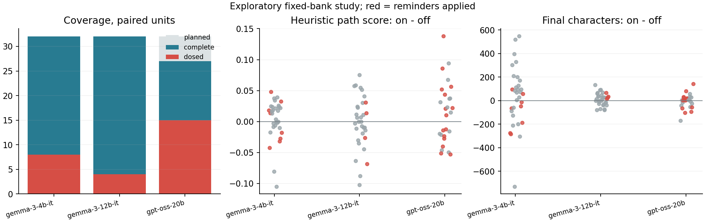

# Frontier Reminder Study on Furnace

Status: **PLANNED ATTEMPTS COMPLETE; LITERARY-QUALITY EFFECT UNKNOWN**.
This is exploratory local-model evidence, not a policy promotion, merge,
release, or public raw-dataset deposit. The independent judge failed order
consistency; its valid JSON must not be mistaken for valid quality evidence.

## Frozen Design

Eight authored Japanese prompt clusters x four sampling replicates per model:
32 planned off/on pairs. The same eight prompts are reused across models, not
24 independent domains. Separate calibration runs freeze profiles before the
paired outputs. Three stages, two candidates, beam width/branching two, no
repairs, aggregation, closure, or memory updates. Temperature 0.8, top-p 0.95,
top-k 40, maximum output 2048 tokens. Heuristic PRM weights are unchanged.

Only nonempty, stop-complete final artifacts are admitted. One failed candidate
blocks its run. Failed trials are not resampled; successful visible prefixes
remain saved. Hidden reasoning text is neither an output artifact nor a judge
input. GPT-OSS uses the pinned final-only Harmony adapter.

| Generator | Planned / Complete Pairs | Eligible Planned / Dosed Complete | Dosed Clusters | Evaluation Runs Complete / Failed |
|---|---:|---:|---:|---:|
| Gemma 3 4B | 32 / 32 | 8 / 8 | 2 | 64 / 0 |
| Gemma 3 12B | 32 / 32 | 4 / 4 | 1 | 64 / 0 |
| GPT-OSS 20B MXFP4 | 32 / 27 | 20 / 15 | 5 | 59 / 5 |

All 24 final calibration runs completed. All 192 planned evaluation attempts
finished; 187 completed and five failed. Thus there are **91/96 complete pairs**,
not 96 successful comparisons. Empty profiles are valid no-dose cases. Eligible
means a calibration profile contains notes; dosed counts actual note application
on complete pairs. Increasing repetitions does not increase prompt diversity.

Runtime: RTX 5090, 32607 MiB, compute capability 12.0, driver 595.84. Gemmas use
frozen vLLM 0.27.1 after preserved TensorRT canary failures, source `9e77ff6`.
GPT-OSS uses managed TensorRT-LLM 1.2.1, native-system render contract v2, source
`47e7dcd`. The independent Mistral-Nemo 12B judge uses managed TensorRT-LLM at
`3d36150`. Full source, weight, tokenizer, and runtime identities are in
[audit.json](audit.json). Family, quantization, renderer, and backend confound
size: this is **not a size-only scaling experiment**.

## Heuristic Measurements

On-minus-off path score, equal-weight prompt means; exploratory 95% percentile
bootstrap over eight prompt means, 5000 draws, RNG seed 20261020. These are
complete-case summaries, not population estimates or multiplicity-adjusted tests.

| Generator | Prompt-Mean Difference [Interval] | Dosed-Pair Mean | No-Dose-Pair Mean |
|---|---|---:|---:|
| Gemma 3 4B | +0.002556 [-0.005410, +0.009989] | -0.000832 | +0.003685 |
| Gemma 3 12B | -0.001115 [-0.012982, +0.011893] | -0.012545 | +0.000518 |
| GPT-OSS 20B | +0.012658 [+0.003033, +0.021565] | +0.013878 | +0.012738 |

The last two columns are unweighted descriptive pair means, not additional
causal estimates. GPT-OSS has a positive complete-case heuristic signal, but
similar variation in no-dose cases. Its five missing pairs are all calibration-
eligible: p03 r03 on, p04 r03 on, p05 r02 off, p05 r03 on, p08 r02 off. All five
failed through length truncation. Selection bias and stochastic variation are
not resolved. Neither literary improvement nor a reminder effect is established.

[primary.json](primary.json) includes drift, magic reward, unresolved conflicts,
length differences, per-pair hashes, and full intervals. No weights or policy
were selected from these outcomes.



## Independent Judge: Negative Qualification Result

Mistral-Nemo-Instruct-2407 saw only each seed and the two final passages, in
both A/B orders, without conditions, notes, or PRM scores. All **182/182**
responses were stop-complete valid JSON. Nevertheless, the frozen configuration
chose **A in 181/182** responses and B once. Reversing order changed the normalized
winner in **90/91** pairs. All 182 presented-prompt hashes match the expected
ordered passages; saved metadata is not the sole evidence of reversal.

| Generator | Consistent On / Off / Tie | Order-Disagreement Unknown | Dosed Unknown |
|---|---:|---:|---:|
| Gemma 3 4B | 0 / 1 / 0 | 31/32 | 8/8 |
| Gemma 3 12B | 0 / 0 / 0 | 32/32 | 4/4 |
| GPT-OSS 20B | 0 / 0 / 0 | 27/27 | 15/15 |

This is not evidence that off wins, nor that the generators have equal quality.
All 27 dosed complete pairs have unknown preference. This frozen judge is not
qualified to support a literary-quality claim. The mechanism could involve the
prompt, renderer, runtime, or model; no universal claim about Nemo follows.
Model judgments were never treated as human gold. OQ006 records the next gate.

A pre-run two-input English/Japanese tokenizer smoke matched corrected older HF
and MistralCommon token sequences (14 and 37 tokens; digest
`bcaf031b141d198512765ab96796e739b5120d258925acae581437ee6b84d58c`).
That smoke did not qualify the judge or establish global tokenizer equivalence.

## Replay, Identity, and Objective Limits

| Generator | Identical No-Dose Finals | Same Root Input + Seed / Identical Output | Reused IDs With Different Text | Accepted Steps Within 140-240 Chars, Off / On |
|---|---:|---:|---:|---:|
| Gemma 3 4B | 0/24 | 48/48 / 19/48 | 101/126 | 2/96 / 2/96 |
| Gemma 3 12B | 1/28 | 56/56 / 25/56 | 103/134 | 28/96 / 29/96 |
| GPT-OSS 20B | 0/12 | 24/24 / 0/24 | 120/120 | 63/81 / 53/81 |

The protocol pairs intended seeds and call ordinals, not bit-identical token
trajectories. Saved-trace replay is distinct from generative repeatability.
These observations do not establish that seeds were ignored or identify one
runtime cause. Stage-local candidate ID equality does not establish text or
lineage identity; automatic revival remains disabled.

The study's 140-240-character target is prompt-only. The unchanged scorer's
grounding-length term saturates at 360 characters. Final median lengths off/on:
4B 954.5/992; 12B 385/396; 20B 180/190. Counts are Python code points. The
observations identify a possible objective mismatch, not its causal mechanism
or a rule that shorter prose is better.

## Completion and Runtime Receipts

| Final Study | Requests Including Two Canaries | Stop-Complete / Incomplete | Completion Tokens | Summed Engine Batch Seconds |
|---|---:|---:|---:|---:|
| Gemma 3 4B | 722 | 722 / 0 | 331718 | 999.2263 |
| Gemma 3 12B | 722 | 722 / 0 | 145351 | 980.5492 |
| GPT-OSS 20B | 704 | 699 / 5 | 329811 | 694.6634 |

Request totals differ because failed runs stop early. Engine token counts are
not normalized visible-output speed; GPT-OSS counts can include discarded
reasoning-channel tokens. Different tokenizers also preclude a direct speed
or quality ranking.

Negative pilots are preserved in [negative-pilots.json](negative-pilots.json):
the 512-token 4B pilot had 0/8 complete calibrations and 0/32 complete pairs
(239 requests, 39 truncated). GPT-OSS's earlier single-user render contract
passed only 1/8 calibrations: 44 stop-finished requests, seven rejected by the
unchanged Harmony channel gate, and zero admitted pairs. The native-system
rerun is a separate frozen protocol, not replacement samples.

TensorRT Gemma canaries failed on attention metadata `kv_layout`; initial vLLM
launches exposed missing process PATH tools and structured-tokenizer handling.
No packages were installed or changed and no weights downloaded. The four
early failed canaries lack original execution manifests. Their status/log hashes
are preserved as a **retrospective recovery index**, not synthesized execution
proof, in [runtime-failures.json](runtime-failures.json).

## Artifacts and Reanalysis

Raw evidence on Furnace:
`/home/ryospiralarchitect/scratch/cmrt-frontier-evidence-20261020/`.
Mac copy: ignored `artifacts/furnace/20261020/`. The complete tar archive is on
both machines; SHA-256:
`c64f92f49e62fe4d521b68a5aa5d068217ad64bfd55707a1be9ebb764caf0225`.
See [validation.json](validation.json) for transfer and local/remote validation
receipts. Managed runtime doctor still matches its freeze; GPU jobs are closed.

With the raw directories available, from the repo root:

```bash
python3 experiments/analyze_frontier_study.py \
  --studies artifacts/furnace/20261020/gemma3-4b-study2 \
    artifacts/furnace/20261020/gemma3-12b-study2 \
    artifacts/furnace/20261020/gptoss20b-study3 \
  --judge artifacts/furnace/20261020/nemo-judge1 \
  --output /tmp/frontier-audit.json
```

The audit rejects unlisted JSON, manifest tampering, substituted judge sources,
wrong passage hashes, or incorrect presented order. Code, recipes, summaries,
and receipts are in PR #6; the full raw corpus is **not published in Git**.

## Open Decisions

- [OQ001: static reminders or influence tuning](../../../notes/open-questions/001-frontier-influence.md).
- [OQ002: exact passage identity or declared lineage](../../../notes/open-questions/002-candidate-identity.md).
- [OQ003: coverage or enriched effect studies](../../../notes/open-questions/003-intervention-coverage.md).
- [OQ004: soft length targets or explicit constraints](../../../notes/open-questions/004-length-objective.md).
- [OQ005: stochastic pairing or execution-invariant replay](../../../notes/open-questions/005-replay-granularity.md).
- [OQ006: automated judge qualification or human anchors](../../../notes/open-questions/006-judge-qualification.md).

No unresolved assessment authorizes automatic tuning, candidate revival, a new
study, model selection, or a production scoring change.
